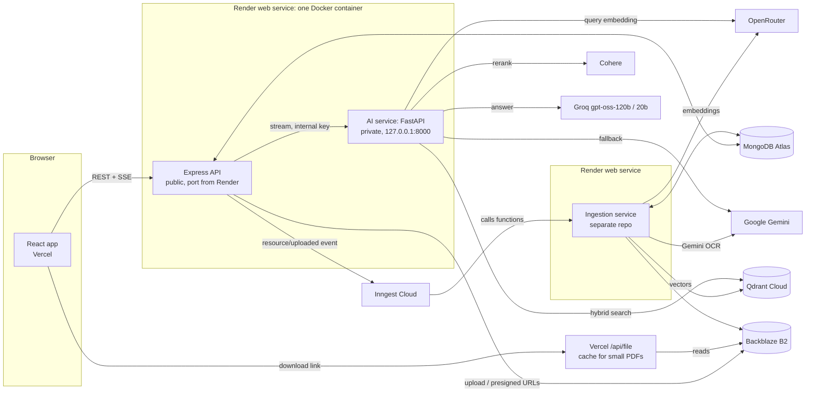

# StudyHub

StudyHub is a study platform for college students. Admins upload notes, previous-year question papers (PYQs), code files and syllabi. Students sign in, get the material for their own academic year, download it, and ask questions to an AI assistant that answers **only from the uploaded notes** and cites the pages it used.

This repository contains the web application. PDF text extraction and indexing run in a separate service: the **StudyHub ingestion** repository (see [Related repositories](#related-repositories)).

---

## Table of contents

1. [What is implemented](#what-is-implemented)
2. [Architecture](#architecture)
3. [Tech stack](#tech-stack)
4. [Repository layout](#repository-layout)
5. [How it works](#how-it-works)
   - [Accounts and roles](#accounts-and-roles)
   - [Resources: upload, storage, download](#resources-upload-storage-download)
   - [Ask AI: the RAG pipeline](#ask-ai-the-rag-pipeline)
   - [Chat history](#chat-history)
   - [Admin tools](#admin-tools)
6. [API reference](#api-reference)
7. [Configuration](#configuration)
8. [Run locally](#run-locally)
9. [Deployment](#deployment)
10. [Evaluation](#evaluation)
11. [Known limitations](#known-limitations)
12. [Related repositories](#related-repositories)

---

## What is implemented

**For students**
- Register with email and password (email verified by a one-time code) or sign in with Google.
- Onboarding: the student picks an academic year; everything they see is scoped to that year.
- Browse and download study resources, PYQs and code files for their subjects; download the current syllabus.
- **Ask AI**: a chat assistant over the uploaded notes.
  - Filter by subject, or search the whole year ("All subjects").
  - Choose exam marks (3, 5, 8 or 16) to get an answer of matching length.
  - Several questions in one message are answered separately.
  - Answers stream in word by word, and show the source documents and page numbers.
  - Every chat is saved; students can reopen, search and delete past chats.
- Account settings: change email (verified by a code), change or reset password.
- Light and dark theme.

**For admins**
- Manage subjects (per year, core or optional).
- Upload, edit, delete resources (study resource, PYQ or code) and syllabi.
- **Background processing monitor**: live progress of PDF text extraction and indexing for every upload, with the reason when something is stuck, and a Retry button.
- Send a feature-announcement email to users.
- Promote all students to the next academic year (allowed 1-15 July only) and roll the promotion back.

---

## Architecture



Key decisions:

- **Express and the AI service share one Render container** to fit the free tier. Express is the only public process; the AI service listens on `127.0.0.1:8000` and requires a shared secret header (`x-internal-key`).
- **Ingestion is a separate service.** It does the slow work (OCR, embedding) and is driven by Inngest, so a long PDF never blocks the web API. The AI service only searches and generates; it never writes to Qdrant.
- **MongoDB is the shared state.** Express creates a `resources` document; the ingestion service updates its status and page progress; the admin panel reads it.

---

## Tech stack

| Layer | Technology |
| --- | --- |
| Frontend | React 19, Vite, Tailwind CSS 4, React Router 7, Axios, lucide-react |
| API | Node.js 22, Express 5, Mongoose 9, JSON Web Tokens, bcryptjs, Multer, Nodemailer, Google Auth Library |
| Database | MongoDB Atlas |
| File storage | Backblaze B2 (S3-compatible API) |
| Background jobs | Inngest (event sending from Express; functions live in the ingestion repo) |
| Vector search | Qdrant Cloud: dense vectors plus a BM25 query, fused with Reciprocal Rank Fusion |
| Embeddings | OpenRouter (`liquid/lfm-2.5-embedding-350m:free`, 1024 dimensions) |
| Reranking | Cohere Rerank (`rerank-v4.0-fast`) |
| Generation | Groq `openai/gpt-oss-120b`, then `openai/gpt-oss-20b`, then Google Gemini |
| AI service | Python 3.13, FastAPI, LangChain (core, Groq, Google GenAI), qdrant-client, httpx |
| Evaluation | Ragas (local scripts only) |
| Hosting | Render (Docker) for API and AI service, Vercel for the frontend and file cache |

---

## Repository layout

```
Study_Hub/
├── Dockerfile                 One image that runs Express + the AI service
├── start.sh                   Starts both processes; exits if either dies
├── client/                    React frontend (deployed on Vercel)
│   ├── api/file.js            Vercel function: serves small PDFs through Vercel's cache
│   └── src/
│       ├── pages/             Dashboard, Resources, PyqCode, AskAIPage, Settings,
│       │                      AdminSubjects, UploadResources, UploadSyllabus, auth pages
│       ├── components/        Navigation, RouteGuard, IngestionMonitor, ...
│       ├── context/           AuthContext, ThemeContext
│       └── api/               Axios instance and API helpers
├── server/                    Express API
│   ├── index.js               App setup and route mounting
│   ├── config/                db, b2Storage, qdrant, inngest
│   ├── controllers/           auth, user, admin, resource, syllabus, ai, ingestion
│   ├── middleware/            authMiddleware (protect), requireAdmin
│   ├── models/                User, Subjects, Resource, Syllabus, Chat, AcademicRollout
│   ├── routes/                one file per area
│   └── utils/sendEmail.js
└── ai-service/
    └── src/ai_service/
        ├── requirements.txt
        ├── studyhub_rag/      The RAG service (see below)
        └── evaluation/        Local test-set generation and Ragas evaluation
```

`studyhub_rag/` modules:

| File | Responsibility |
| --- | --- |
| `main.py` | FastAPI app: `/ping`, `/health`, `/chat`, `/chat/stream` (SSE); checks the internal key |
| `config.py` | Reads and validates environment variables at startup |
| `chain.py` | The whole RAG flow: split questions, retrieve, rerank, expand to pages, build prompt, route, stream |
| `retriever.py` | Qdrant hybrid query (dense + BM25 with RRF) with metadata filters |
| `embeddings.py` | Query embeddings through OpenRouter with key rotation |
| `reranker.py` | Cohere rerank wrapped as a LangChain document compressor |
| `pages.py` | Rebuilds the full PDF page for each best chunk |
| `profiles.py` | Answer length per marks value; multi-question splitting |
| `prompts.py` | The grounded answer prompt and length rules |
| `llm.py` | Groq/Gemini model chains and the routing rule |
| `formatting.py` | Context text for the prompt and the sources list for the UI |

---

## How it works

### Accounts and roles

- **Register:** username, email, password (minimum 8 characters, letters and digits). The password is hashed with bcrypt. A 6-digit code is emailed and expires in 10 minutes; the account must be verified before use.
- **Login:** email and password, or Google sign-in. The API issues a JWT valid for 30 days, sent as an `httpOnly` cookie (`secure` and `sameSite=strict` in production) and also accepted as a `Bearer` token.
- **Password flows:** forgot-password (code by email, then reset), change password while signed in, and change email (code sent to the new address).
- **Roles:** `student` and `admin`. `protect` authenticates every request; `requireAdmin` guards everything under `/admin`. The frontend `RouteGuard` sends users to the correct step: verify, then onboarding, then dashboard.
- **Year:** after onboarding the student's year is stored on the user. The server always takes the year from the logged-in user, never from the request, so a student cannot read another year's material.

### Resources: upload, storage, download

**Upload (admin)**
1. The browser sends the file to `POST /admin/resources`; Multer writes it to a temporary file.
2. The server computes a SHA-256 hash, uploads the file to Backblaze B2 (multipart), and creates a `resources` document with its subject, year, category and type (`resource`, `pyq` or `code`).
3. If the file is a PDF the status is `queued` and the server sends a `resource/uploaded` event to Inngest (the event id is `ingest-<resourceId>`, so a repeat is ignored). Other files get status `skipped`.
4. If sending the event fails, the upload still succeeds; the ingestion service's hourly check restarts files that stay queued.

**Download (student or admin)**
- Files up to 4 MB: the API returns a link to the Vercel function `/api/file`, signed with an HMAC. Vercel fetches the file from B2 once and caches it, so repeated downloads do not touch B2.
- Larger files: the API returns a presigned B2 URL valid for one hour.
- Students only receive resources of their own year.

**Delete (admin)**
The resource is first marked `deleting` so the ingestion service stops writing. Then every B2 version of the file is removed, the vectors are deleted from Qdrant, the OCR page texts are deleted from MongoDB, and a `resource/deleted` event lets the ingestion service clean up again after any running step finishes.

**Edit (admin)**
Changing title, subject, year or category sends a `resource/updated` event; the ingestion service copies the new values into the Qdrant payload, so search filters stay correct.

### Ask AI: the RAG pipeline

Browser → `POST /ai/chat/stream` (Express) → `POST /chat/stream` (AI service) → answer streamed back as server-sent events (SSE).

**Express**
1. Validates the question (at most 2000 characters) and the marks value (3, 5, 8, 16 or none).
2. Builds filters: `year` from the logged-in user, and `subject` (resolved from the subject id to its name) unless "All subjects" is chosen.
3. Saves the question in the chat, forwards the request to the AI service, relays each event to the browser, collects the answer text and sources, and saves the answer when the stream ends.
4. Allows one active answer per user at a time and cancels the AI request if the browser disconnects.

**AI service** (`chain.py`)
1. **Split questions.** A message with numbered lines (`1.`, `Q2)`) or several sentences that all end in `?` becomes up to 5 separate questions.
2. **Hybrid search.** For each question the query is embedded (OpenRouter) and sent to Qdrant with two prefetches, dense vector and BM25, both carrying the year/subject filter. Results are fused with Reciprocal Rank Fusion.
3. **Rerank.** Cohere reorders the candidates and keeps the best ones. If Cohere is unavailable, the search order is used.
4. **Expand to pages.** Notes are stored as chunks of about 480 tokens, and only the first chunk of a page contains its heading. For each best chunk, the service reads all chunks of that page from Qdrant and joins them in order, removing the overlap. A page is kept only if its rerank score is at least 30% of the best page's score. Pages are given to the model in reading order.
5. **Prompt.** One grounded prompt: use only the supplied context, keep the source's wording and order, include every item the context lists for the topic, add no introduction, conclusion or outside facts, and say what the context does not cover. If nothing relevant is found the reply is *"The provided context contains insufficient information to answer this query."*
6. **Route to a model.** The service estimates the full request (prompt + context + expected answer). If it fits within 7000 tokens (the Groq free per-minute limit), it goes to Groq `gpt-oss-120b`, falling back to `gpt-oss-20b` and then Gemini. Larger requests, such as 16-mark answers or several questions, go directly to Gemini.
7. **Stream.** Events sent to the client: `status` (searching, writing), `meta`, `sources`, `token`, `done` or `error`.

**Answer length by marks** (one question, single-spaced A4)

| Marks | Tokens | Words | Pages | Pages of notes given to the model (max) |
| --- | --- | --- | --- | --- |
| 16 | 3584 | 2688 | 6 | 4 |
| 8 | 2560 | 1920 | 4 | 3 |
| 5 | 1536 | 1152 | 3 | 3 |
| 3 | 1024 | 768 | 1.5 | 2 |
| none | up to 1200 | as needed | - | 3 |

The length is a target, not a quota: if the notes contain less, the answer stops instead of adding outside text.

### Chat history

Each chat belongs to one user and stores its messages (question, options used, answer, sources). Students can list recent chats, search by title or message text, reopen a chat to continue it, and delete it. A chat holds at most 100 messages.

### Admin tools

- **Background processing monitor** (Upload Resources page). Reads each resource's status from MongoDB and shows: current step, pages read (OCR) and pages indexed, whether the file is waiting in line, paused for a rate limit, retrying after an error, stuck, failed or done, and the saved error message. **Retry** resets a failed or stuck file and sends a new event. The panel refreshes every 4 seconds while work is running.
- **Academic year promotion** moves every student up one year, only from 1 to 15 July, once per cycle, with a rollback endpoint.
- **Feature announcement** sends an email to users.

---

## API reference

All routes except register, login, Google sign-in and forgot-password require authentication. `/admin/*` additionally requires the `admin` role.

| Area | Method and path | Purpose |
| --- | --- | --- |
| Auth | `POST /auth/register`, `/auth/login`, `/auth/google`, `/auth/logout` | Account creation and sessions |
| | `POST /auth/verify-otp`, `/auth/resend-otp` | Email verification |
| | `GET /auth/me` | Current user |
| | `POST /auth/change-email`, `/auth/verify-email-change` | Email change |
| | `POST /auth/forgot-password/send-otp`, `/verify-otp`, `/reset` | Forgot password |
| | `POST /auth/send-password-reset-otp`, `/verify-password-reset-otp`, `/reset-password`, `/update-password` | Password change while signed in |
| User | `PATCH /users/onboarding`, `GET /users/subjects` | Choose year; subjects for the year |
| Resources | `GET /resources`, `GET /resources/:id/download` | Study resources for the student's year |
| | `GET /resources/pyq-code`, `GET /resources/pyq-code/:id/download` | PYQs and code files |
| Syllabus | `GET /syllabus`, `GET /syllabus/download` | Current syllabus |
| Ask AI | `POST /ai/chat/stream` | Ask a question (SSE) |
| | `GET /ai/chats?q=`, `GET /ai/chats/:id`, `DELETE /ai/chats/:id` | Chat history |
| Admin | `GET/POST /admin/subjects`, `PUT/DELETE /admin/subjects/:id` | Subjects |
| | `GET/POST /admin/resources`, `PUT/DELETE /admin/resources/:id`, `GET /admin/resources/:id/download` | Resources |
| | `GET/POST /admin/syllabus`, `PUT/DELETE /admin/syllabus/:id` | Syllabi |
| | `GET /admin/ingestion`, `POST /admin/ingestion/:id/retry` | Processing monitor |
| | `POST /admin/feature-announcement`, `/admin/year-rollover`, `/admin/year-rollover/rollback` | Announcements and year promotion |
| Health | `GET /`, `GET /api/ai/ping` | Express and AI service liveness |

AI service (private, called only by Express): `GET /ping`, `GET /health`, `POST /chat`, `POST /chat/stream`.

---

## Configuration

Never commit `.env` files. Each variable is read at startup; missing required values stop the service with a clear message.

### Express (`server`)

| Variable | Purpose |
| --- | --- |
| `MONGO_URI` | MongoDB connection string (the database name in the URI is the one the ingestion service must also use) |
| `JWT_SECRET` | Signs login tokens |
| `PORT`, `NODE_ENV` | Set by Render |
| `GOOGLE_CLIENT_ID` | Google sign-in |
| `EMAIL_USER`, `EMAIL_PASS` | Sending verification and announcement emails |
| `B2_ENDPOINT`, `B2_REGION`, `B2_KEY_ID`, `B2_APPLICATION_KEY`, `B2_BUCKET_NAME` | Backblaze B2 |
| `FILE_BASE_URL`, `FILE_LINK_SECRET` | Vercel file-cache links (the secret must match the Vercel function's) |
| `QDRANT_URL`, `QDRANT_API_KEY`, `QDRANT_COLLECTION` | Deleting vectors when a resource is deleted (default collection `resources`) |
| `FASTAPI_URL` | AI service URL, `http://127.0.0.1:8000` in the Docker image |
| `AI_INTERNAL_KEY` | Shared secret with the AI service (same value on both sides) |
| `INNGEST_EVENT_KEY` | Sends events to Inngest Cloud (use `INNGEST_DEV=1` locally instead) |

### AI service (`ai-service`)

| Variable | Required | Purpose |
| --- | --- | --- |
| `QDRANT_URL`, `QDRANT_API_KEY` | yes | Same cluster the ingestion service writes to |
| `OPENROUTER_API_KEYS` | yes | Comma-separated; query embeddings, rotated on rate limits |
| `EMBED_MODEL`, `EMBED_DIMENSIONS` | no | Must match ingestion (`liquid/lfm-2.5-embedding-350m:free`, 1024) |
| `COHERE_API_KEY` | yes | Reranking |
| `GROQ_API_KEYS` | yes | Comma-separated Groq keys |
| `GEMINI_KEYS` | no | Fallback and large requests |
| `AI_INTERNAL_KEY` | yes in production | Shared secret with Express |
| `GROQ_MODEL`, `GROQ_FALLBACK_MODEL`, `GEMINI_ANSWER_MODEL` | no | Model overrides |
| `GROQ_REQUEST_BUDGET` | no | Largest request sent to Groq (default 7000 tokens) |
| `GROQ_REASONING_EFFORT` | no | `low` (default), `medium` or `high` |
| `RETRIEVE_K`, `RERANK_TOP_N`, `MAX_QUESTIONS`, `MAX_QUESTION_CHARS` | no | Search and input limits |
| `EXPAND_TO_PAGES`, `MIN_PAGE_SCORE_RATIO`, `MAX_CONTEXT_TOKENS` | no | Whole-page context settings |

### Vercel file function (`client/api/file.js`)

`B2_REGION`, `B2_KEY_ID`, `B2_APP_KEY`, `BUCKET`, `FILE_LINK_SECRET`.

### Frontend

`VITE_API_URL`: base URL of the Express API (default `http://localhost:5000`).

---

## Run locally

Requirements: Node.js 22, Python 3.13, and accounts or keys for MongoDB, Backblaze B2, Qdrant, OpenRouter, Cohere, Groq and Inngest (dev mode).

```bash
# 1. API
cd server
npm install
# create server/.env with the Express variables above
npm run start               # http://localhost:5000

# 2. AI service
cd ai-service/src/ai_service
python -m venv .venv && source .venv/bin/activate
pip install -r requirements.txt
# create .env here with the AI service variables above
uvicorn studyhub_rag.main:app --port 8000

# 3. Frontend
cd client
npm install
npm run dev                 # http://localhost:5173
```

Set `FASTAPI_URL=http://127.0.0.1:8000` in the API's `.env`. Run the ingestion service as described in its own repository so uploaded PDFs are processed.

Install dependencies from `client` and `server` separately; do not run `npm install` in the repository root.

---

## Deployment

**API and AI service: one Render web service (Docker)**
1. The repository root must contain the `Dockerfile` and `start.sh`.
2. In Render choose *New, Web Service*, connect the repository, set the language to **Docker**, and leave the root directory empty.
3. Add the Express and AI service variables listed above to the same service.
4. Set the health check path to `/api/ai/ping`.

The Dockerfile builds in two stages: it installs Node dependencies, then builds a Python image that also contains the `node` binary. The image copies `server/` and `ai-service/src/ai_service/` and runs `start.sh`, which starts uvicorn (one worker, `127.0.0.1:8000`) and Node in the same container. If either process exits, the container exits and Render restarts it. Node's memory is capped (`--max-old-space-size=180`) to stay within 512 MB.

**Frontend: Vercel**
Deploy `client` as a Vite project, set `VITE_API_URL`, and add the file-function variables. Add the frontend's domain to the allowed origins in `server/index.js`.

**Ingestion: a separate Render service.** See the ingestion repository.

On Render's free plan a service sleeps after about 15 minutes without traffic; the first request afterwards takes about a minute.

---

## Evaluation

The scripts in `ai-service/src/ai_service/evaluation/` are for local use only; they are not part of the deployed service.

- `testset_generator.py` builds a question set from the indexed notes.
- `evaluate.py` runs the questions through the same RAG code the API uses and scores the answers with Ragas.
- `check_answer.py` compares an answer with its source text and lists source lines missing from the answer and answer lines not found in the source.

Install `requirements-eval.txt` to run them.

---

## Known limitations

- **Hybrid search currently behaves like dense search plus rerank.** The search sends a BM25 query to Qdrant, but the ingestion service stores only the dense vector (it creates the `bm25` vector slot in the collection and never fills it). Keyword matching is therefore not contributing until ingestion also writes BM25 vectors for each chunk.
- Answer quality for long answers depends on the free-tier models (Groq `gpt-oss`, Gemini) and has been checked on sample pages only; run the evaluation scripts after any prompt or model change.
- Free-tier hosting means cold starts and shared memory between Express and the AI service.
- Only PDFs are text-extracted. Code files and other uploads are stored and downloadable but not searchable by the assistant.

---

## Related repositories

- **StudyHub ingestion**: the background service that extracts text from PDFs with Gemini OCR, embeds it, and stores it in Qdrant.